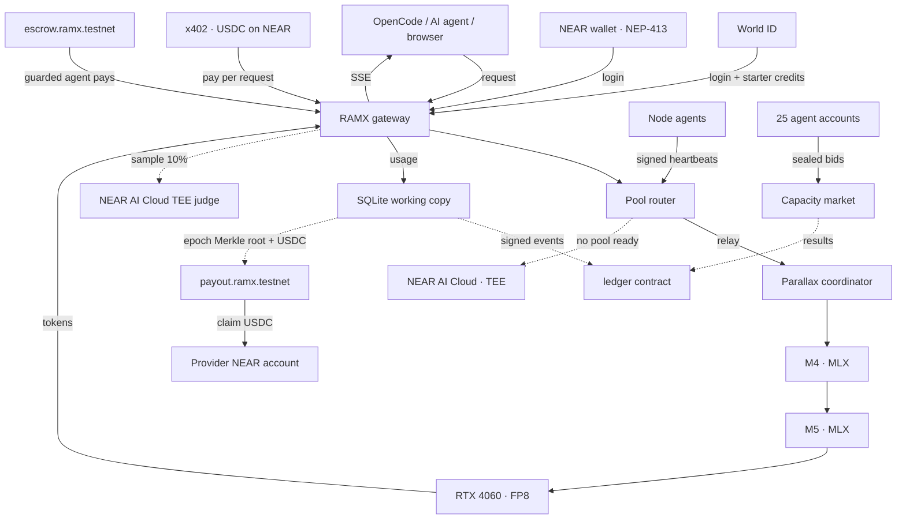

# RAMX

**Pool the laptops. Split the model. Settle it on NEAR.**

RAMX turns the idle memory of everyday Apple and NVIDIA laptops into one shared AI cloud. Nearby machines form a **GPU Pool**, each holds a slice of a model's layers, and together they serve a model **none of them could load alone**. People and AI agents use it through an OpenAI-compatible API, paying with credits or per request in USDC with x402. **NEAR runs the economy:** every balance change is a signed event on a ledger contract, providers claim their USDC from a Merkle payout contract, and an agent's wallet can be held to a budget by a contract it cannot override. Built for NEAR HACKATHON 2026.

[Repository](https://github.com/yashhhhapexxxx/RAMX) · Website: [ramx-eight.vercel.app](https://ramx-eight.vercel.app) · Hosted gateway: [ramx-gateway.onrender.com](https://ramx-gateway.onrender.com/v1/models) · Demo video: [x.com/gpuxram](https://x.com/gpuxram/status/2121716405552959688)

## At a glance

| | |
|---|---|
| **Problem** | Useful AI models are bigger than any one laptop's memory, while gigabytes sit idle on the laptops around us. Pooling them is only half the job: an open network also needs identity, fair accounting, payment and limits on what an AI agent can spend. |
| **Solution** | A gateway that routes each request to a GPU Pool of laptops (Parallax splits the layers), bills it honestly, and records every payment, payout and decision on NEAR. |
| **Who earns** | **A college student goes to sleep; their laptop goes to work.** Overnight it serves its slice of the model, and in the morning the student wakes up to credits for their own AI and USDC they claim on NEAR. |
| **Proven on chain** | A full cycle, three times: an agent pays with x402 → a laptop pool answers → signed ledger events → epoch payout posted → provider claims 80% in USDC. |
| **Agents** | Pay per request with no sign-up; an LLM decides what to buy; a guarded agent is limited by a NEAR contract, and five prompt-injection attacks are refused on chain. |
| **Swarm** | 25 agents on their own NEAR sub-accounts, each bidding with an LLM, clear sealed-bid rounds for capacity; every round is a signed event anyone can recompute. |
| **Privacy** | Per-request privacy up to end-to-end encryption into a NEAR AI Cloud TEE; personal data never reaches an untrusted laptop; the chain holds only salted hashes. |
| **Tests** | gateway 246 · shared 67 · agent-client 19 · swarm-sim 7 · frontend 117 · Rust contracts 34 (ledger 11, payout 16, escrow 7) |

## Verify it in two minutes (no keys, no accounts)

Everything below runs against NEAR testnet and the hosted gateway. Nothing needs a key.

```bash
git clone https://github.com/yashhhhapexxxx/RAMX.git && cd RAMX && pnpm install   # Node 24+, pnpm

# 1. A signed ledger event from the laptop-pool run: schema and ed25519 signature checked
#    against the public key the ledger contract publishes
node gateway/src/verify-event.ts AwcYdvPxQsaboi2Zkhurg41UgvnohUkZiz5vhH2kvG75
# → {"contract":"ledger-v2.ramx.testnet","seq":34,"type":"x402_payment","schema":"valid","signature":"valid"}

# 2. The TEE judge's verdict on a pool answer, signed and on chain
node gateway/src/verify-event.ts ApqcNg5LjVMNY9KLJChtf4dmHvA4ZVex9vjLdbccjKpi
# → {"seq":37,"type":"tee_check","schema":"valid","signature":"valid"}

# 3. Two capacity-market rounds where all 25 agents bid with an LLM (hosted gateway's ledger)
LEDGER_CONTRACT_ID=ledger-v3.ramx.testnet node gateway/src/verify-event.ts 3R9XuivrPFPEXTYoh8gSsEqU6J7aurQBB83o5gUN9ucQ
# → seq 39 and 40, "type":"swarm_cleared", "schema":"valid", "signature":"valid"

# 4. The live gateway asks an unpaid agent for USDC (HTTP 402 with an x402 price on near:testnet)
curl -si -X POST https://ramx-gateway.onrender.com/v1/chat/completions \
  -H 'content-type: application/json' \
  -d '{"model":"Qwen/Qwen3-8B-FP8","messages":[{"role":"user","content":"hi"}]}' | head -1
# → HTTP/2 402
```

Then open any transaction in [On-chain evidence](#on-chain-evidence-near-testnet), or try the chat at [ramx-eight.vercel.app](https://ramx-eight.vercel.app).

## How it works

The **gateway chooses a GPU Pool; Parallax chooses its GPU stages.** Model layers stay on the laptops, which pass hidden states to each other over the local network. The gateway handles identity, billing, payment and routing, and NEAR holds the money and the audit trail. When no pool is ready, the gateway serves the request from a model in NEAR AI Cloud's secure hardware (TEE), so the service keeps answering.



- **Identity.** Log in with **World ID** (one account per verified human) or **any NEAR wallet that can sign a message** (Meteor, MyNearWallet, HERE, Sender, Nightly, Intear, HOT, OKX, Coin98, WELLDONE, NEAR Snap, Ledger). A wallet signs a NEP-413 message, not a transaction, and the gateway checks on chain that the key is a full-access key of that account. New accounts get 10,000 starter credits for 14 days, and `STARTER_DAILY_GRANTS` caps how many accounts get them per day, so free testnet accounts cannot drain the pool.
- **Discovery and routing.** Laptops announce themselves with signed heartbeats. The router picks a pool by fresh heartbeats, layer coverage and reliability (success and uptime).
- **Honest accounting.** SQLite holds atomic credit holds and settlements; every balance change is also an ed25519-signed event on the ledger contract, which refuses gaps and duplicates. Credits split 90% to the serving laptops by layers, 5% burned and 5% to a reserve. 80% of x402 USDC income goes to providers each epoch: the treasury posts a Merkle root and the USDC in one `ft_transfer_call`, and each provider claims its own leaf.
- **Honest billing.** The gateway bills `min(reported output tokens, observed + 8)`, so a pool that over-reports loses reliability, not the user's money. A 10% sample of pool answers is judged by a NEAR AI Cloud model in a TEE, with a fresh-nonce attestation and a signed verdict (a plausibility check, not a proof of correct execution).
- **Guarded agents.** An agent account can hold only a function-call key for `escrow.pay`. The escrow contract enforces its owner's policy on chain (allowed payees, per-call maximum, total budget, pause), so a prompt-injected agent cannot pay a stranger, overspend or change its own limits.
- **Privacy.** Each request picks who may see it (`x-ramx-privacy`: `trusted-ends`, `trusted-all` or `tee`), and the mode is signed into its ledger event. A `tee` request can be **end-to-end encrypted**: the client attests the enclave itself and encrypts to its key, so the gateway relays only ciphertext. The web chat offers the same choice as a switch (**Normal · Trusted laptops · Secure hardware (TEE)**) and encrypts **in the browser**. Before a prompt reaches an untrusted laptop, emails, phone numbers, card numbers and secrets become placeholders such as `[EMAIL_1]`, restored in the answer. Details: [PRIVACY-AND-PRIVATE-AI.md](PRIVACY-AND-PRIVATE-AI.md).
- **Capacity market.** Agents bid for priority slots in 30-second sealed-bid rounds (commit, reveal, one uniform price per model). Each agent is its own NEAR account and signs its own bids, and each can choose its bid with an LLM. Rules: [swarm-sim/RULES.md](swarm-sim/RULES.md).
- **Tools stay local.** With OpenCode, files and tools stay on the requester's laptop; only the model calls go to the pool.

## What runs on NEAR

| Contract or account | Role |
|---|---|
| [`ledger-v2.ramx.testnet`](https://testnet.nearblocks.io/address/ledger-v2.ramx.testnet), [`ledger-v3.ramx.testnet`](https://testnet.nearblocks.io/address/ledger-v3.ramx.testnet) | Audit ledger: signed, gap-free events with NEP-297 logs. v2 records the laptop-pool runs, v3 the hosted gateway (same code and signing key; first test run on [`ledger.ramx.testnet`](https://testnet.nearblocks.io/address/ledger.ramx.testnet)) |
| [`payout.ramx.testnet`](https://testnet.nearblocks.io/address/payout.ramx.testnet) | Epoch payouts: Merkle root and USDC arrive together; each provider claims its own leaf |
| [`escrow.ramx.testnet`](https://testnet.nearblocks.io/address/escrow.ramx.testnet) | Guarded agent wallets: allow list, per-call maximum, budget, pause, owner-only policy |
| `treasury.ramx.testnet` / `relayer.ramx.testnet` | x402 payee and epoch settler / x402 relayer that pays the agents' gas |
| `agent-1.ramx.testnet` / `agent-2.ramx.testnet` | Open agent (pays with x402) / guarded agent (function-call key on `escrow.pay` only) |
| `buyer-1…20.swarm.ramx.testnet`, `seller-1…5.swarm.ramx.testnet` | The 25 market agents, one sub-account and one key each |
| `3e2210e1…afcb8af` | USDC (Circle, NEP-141, 6 decimals) |
| NEP-413, NEP-297, NEP-366, NEP-141 | Wallet login, event logs, meta-transactions for x402, USDC |
| NEAR AI Cloud | TEE fallback, TEE judge, private and end-to-end encrypted requests |

## Tracks

Each track links to a short write-up with the transactions that back it.

| Track | What RAMX delivers | Proof on NEAR testnet | Write-up |
|---|---|---|---|
| **AI Security & Defense** | A guarded agent holds only a function-call key for `escrow.pay`, and the escrow contract enforces its owner's policy on chain. `pnpm attack` plays a prompt-injected agent: all five attacks are refused by the chain. Signed ledger events, NEP-413 logins checked against on-chain keys, billing capped at observed tokens, a TEE judge that flags implausible pool answers, secrets kept off untrusted laptops. | [J4YypM…](https://testnet.nearblocks.io/txns/J4YypMMUmYSDv87xA4bAjUTTUELAaFofrzy5zS7J3hja), [EKwP6t…](https://testnet.nearblocks.io/txns/EKwP6tQZLgaHQNFS9ALqJavzjpUD73t4VrZH1TAJxTFG), [ApqcNg…](https://testnet.nearblocks.io/txns/ApqcNg5LjVMNY9KLJChtf4dmHvA4ZVex9vjLdbccjKpi) | [AI-SECURITY-AND-DEFENSE.md](AI-SECURITY-AND-DEFENSE.md) |
| **Agent Economy** | Agents buy inference on their own: HTTP 402 → USDC with x402 → answer, no sign-up, gas paid by a relayer. In goal mode an LLM decides each purchase and stops on its own. Providers are paid from agent income every epoch. | [Dj2U2e…](https://testnet.nearblocks.io/txns/Dj2U2ey6YSgEzJBKjLAPWhemBfsN282XDNRTGztVGTRu), [CdHtTp…](https://testnet.nearblocks.io/txns/CdHtTp8EiMx1Yr5aRNLdwDceykVERCEfbTMpNFCJmeYJ), [2MojW4…](https://testnet.nearblocks.io/txns/2MojW4wAUr7SWR46cdmd4eNfwA3Qo53dc35onPHquEdC) | [AGENT-ECONOMY.md](AGENT-ECONOMY.md) |
| **Privacy & Private AI** | Per-request privacy (`trusted-ends`, `trusted-all`, `tee`), optionally **end-to-end encrypted** into a NEAR AI Cloud enclave so even RAMX sees only ciphertext, also in the web chat. Fresh-nonce attestation and the enclave's signature on every TEE answer. Salted hashes on chain, signed privacy mode, personal data replaced before untrusted laptops, transcripts encrypted and deleted after 28 days. | [HJTFzc…](https://testnet.nearblocks.io/txns/HJTFzcamXQFZ8pm4DxS3U2vgy8bsSDqTBHtibLWP4pRH), [yhGjQC…](https://testnet.nearblocks.io/txns/yhGjQC65PQGnE17wmZuC7auC8mypBpHnbZCfudrj9rR), [4Tbba2…](https://testnet.nearblocks.io/txns/4Tbba2xTADjtnE8KCC1PVDcjg6UAehNktecnC4ssQ36b) | [PRIVACY-AND-PRIVATE-AI.md](PRIVACY-AND-PRIVATE-AI.md) |
| **AI Swarms** | 25 agents, each on its own NEAR sub-account and each choosing its bid with an LLM within a private limit, trade priority inference in commit–reveal sealed-bid rounds with one uniform price per model and pooled group orders. Every round is a signed event with hashes anyone can recompute. | [3R9Xui…](https://testnet.nearblocks.io/txns/3R9XuivrPFPEXTYoh8gSsEqU6J7aurQBB83o5gUN9ucQ), [z4HWQ8…](https://testnet.nearblocks.io/txns/z4HWQ8pKxZBQskzxjZTCrZqBVD4XK4C9pUVAAvMst97) | [AI-SWARMS.md](AI-SWARMS.md) |
| **Open Innovation** | Idle laptop memory as a shared, paid, verifiable AI utility: Apple and NVIDIA laptops serve one model none of them could load alone, behind an OpenAI-compatible API, with every payment and payout on chain. **A student's laptop works while they sleep, and they wake up to credits and USDC they claim on NEAR.** | [TSu5Cy…](https://testnet.nearblocks.io/txns/TSu5CyYnuLC8G4wAFmkPR1h3DJytX42LJ1rggfgUmfc), [AuYYgQ…](https://testnet.nearblocks.io/txns/AuYYgQ1kdt1wU5NGxmEt8Ah3mi5fTDMQyqb2qoVh4wRw) | [OPEN-INNOVATION.md](OPEN-INNOVATION.md) |

## On-chain evidence (NEAR testnet)

| Action | Transaction |
|---|---|
| Agent pays per request with x402 (USDC → treasury) | [G3rzbD…](https://testnet.nearblocks.io/txns/G3rzbD1y6sEfAfJA79tH8aQmBYsj3jYDEEM5XphzNJY4), [2v7At7…](https://testnet.nearblocks.io/txns/2v7At7Ez6x31TtsaZyntsBSPrwnuBVmoygSDPXgMgdth) |
| Signed ledger events for those payments (verified) | [GbVxSJ…](https://testnet.nearblocks.io/txns/GbVxSJh5HzigSiQDBwTEJppGUzaBhzg2g6pAhXZeTbXZ), [GTduTH…](https://testnet.nearblocks.io/txns/GTduTHBtBbqRHLFDa27tmfrhqHCiUGaCNcUkVDvy91EA) |
| Agent pays with x402, answer served by a GPU Pool (Qwen3-8B on an Apple M5 laptop, all 36 layers) | [CdHtTp…](https://testnet.nearblocks.io/txns/CdHtTp8EiMx1Yr5aRNLdwDceykVERCEfbTMpNFCJmeYJ), [Fcs6Ax…](https://testnet.nearblocks.io/txns/Fcs6Ax8JEPB3j8ba9tVWTKoMhvh6uyye1F9unhnTm8C7), [FyRRhz…](https://testnet.nearblocks.io/txns/FyRRhzguo7LUjKWbMTmUe69uqDxnmi3qS2QEJajhXqZu) (payments), [AwcYdv…](https://testnet.nearblocks.io/txns/AwcYdvPxQsaboi2Zkhurg41UgvnohUkZiz5vhH2kvG75), [BQWT9t…](https://testnet.nearblocks.io/txns/BQWT9tkDB7EJ1EYU7QKrQcyXfW5uwMk3KF9QjM8eih3g), [7V45St…](https://testnet.nearblocks.io/txns/7V45SttQ8oFcgdyYUzXhsAJ9NqbkDpi1FBDuBrMfewfP) (ledger events, verified) |
| TEE judge on a sampled pool answer: the NEAR AI Cloud judge (attested, signature checked) rated it `implausible`; signed `tee_check` event, seq 37 | [ApqcNg…](https://testnet.nearblocks.io/txns/ApqcNg5LjVMNY9KLJChtf4dmHvA4ZVex9vjLdbccjKpi) |
| Treasury posts the epoch payout (Merkle root + USDC) | [E7xsCi…](https://testnet.nearblocks.io/txns/E7xsCinFzbNFKCgSobtUQcF5mxKhK2tqwUPwYFG742pD) |
| Provider claims its share with a Merkle proof (80% of the x402 income → `provider-1.ramx.testnet`) | [2MojW4…](https://testnet.nearblocks.io/txns/2MojW4wAUr7SWR46cdmd4eNfwA3Qo53dc35onPHquEdC) |
| Goal-mode agent: an LLM chose each purchase, paid for each with x402 and stopped on its own: 5 paid requests, 0.01 of a 0.05 USDC budget | [PUYPyL…](https://testnet.nearblocks.io/txns/PUYPyL8Ez2hj7vu6m6pc9CbwVPGhMbZr5yXF9r3byA7), [Dj2U2e…](https://testnet.nearblocks.io/txns/Dj2U2ey6YSgEzJBKjLAPWhemBfsN282XDNRTGztVGTRu), [C6q8EP…](https://testnet.nearblocks.io/txns/C6q8EPDfnE1uptywPXXZodpbZXYsBZ4xZBPmpLSmefcE), [AfvqBG…](https://testnet.nearblocks.io/txns/AfvqBG7QwXQRdsQnMnHidiwK7jcPwLnvt2TT4Z9RZoyi), [XLnLG1…](https://testnet.nearblocks.io/txns/XLnLG1HEtgUN1X5TiXjogxQ3FDw7HHX2tZpLEe7U5M1) |
| Guarded agent pays through the escrow, then gets an answer | [9gFGWr…](https://testnet.nearblocks.io/txns/9gFGWr23xEkdqPXF97T5Y5FHNgP6caHTaqA7sEyRXaPh) |
| Refused on chain: payee not on the allow list | [J4YypM…](https://testnet.nearblocks.io/txns/J4YypMMUmYSDv87xA4bAjUTTUELAaFofrzy5zS7J3hja) |
| Refused on chain: above the per-call limit | [EKwP6t…](https://testnet.nearblocks.io/txns/EKwP6tQZLgaHQNFS9ALqJavzjpUD73t4VrZH1TAJxTFG) |
| Capacity market, all 25 agents bidding with an LLM: two rounds cleared, `swarm_cleared` events seq 39–42 (verified) | [3R9Xui…](https://testnet.nearblocks.io/txns/3R9XuivrPFPEXTYoh8gSsEqU6J7aurQBB83o5gUN9ucQ), [z4HWQ8…](https://testnet.nearblocks.io/txns/z4HWQ8pKxZBQskzxjZTCrZqBVD4XK4C9pUVAAvMst97) |
| Capacity market, first round (random bids, first ledger) | [GfbcX7…](https://testnet.nearblocks.io/txns/GfbcX7ofwgcJHVG2Q2meXCjpEGdXn3zZ1dypo2QP88jz) |
| Private request (`tee`) on the hosted gateway: served in NEAR AI Cloud secure hardware with attestation; the ledger event holds only salted hashes, which the caller recomputed and matched | [GWcfcW…](https://testnet.nearblocks.io/txns/GWcfcW9BQF8q59UernT5zcc8utbH4m9fymNpyX1NtQg) (payment), [Cmsm3o…](https://testnet.nearblocks.io/txns/Cmsm3oEZxPbhiQK2DmrFTmHD8rvJozLRuQA5sBMi8L9g) (ledger event) |
| Private request (`trusted-all`) with no trusted laptop online: sent to secure hardware, never to an untrusted laptop | [4Tbba2…](https://testnet.nearblocks.io/txns/4Tbba2xTADjtnE8KCC1PVDcjg6UAehNktecnC4ssQ36b) (payment), [BjBAz9…](https://testnet.nearblocks.io/txns/BjBAz9RrLiLJuCwaNSjkpnTAYQ2xvapcGabHs3HVnQdm) (ledger event) |
| End-to-end encrypted request: the client attested the enclave, RAMX relayed only ciphertext, the answer was decrypted on the client; the signed event says `e2ee: true` and holds no text; all 16 self-checks passed | [HJTFzc…](https://testnet.nearblocks.io/txns/HJTFzcamXQFZ8pm4DxS3U2vgy8bsSDqTBHtibLWP4pRH) (payment), [yhGjQC…](https://testnet.nearblocks.io/txns/yhGjQC65PQGnE17wmZuC7auC8mypBpHnbZCfudrj9rR) (ledger event) |

### The full cycle, three times

Agents pay with x402, a laptop pool answers, the ledger records it, the treasury posts the epoch and the provider claims its USDC. The whole loop ran three separate times, and every epoch was fully claimed: 4,800 of 4,800 units each, exactly 80% of the 0.006 USDC paid.

| Run | Agent payments (pool-served) | Epoch payout posted | Provider claim |
|---|---|---|---|
| **Run 1** | [Gpxq3h…](https://testnet.nearblocks.io/txns/Gpxq3hxD4JVWvgmAS2Ps6Y4j4DG2CyQWoSssWYvzk1j3), [DtrZwH…](https://testnet.nearblocks.io/txns/DtrZwHJwdg62Xd6K6T4Lo29zt5GqtZKbGFgV6urXG1pd), [TSu5Cy…](https://testnet.nearblocks.io/txns/TSu5CyYnuLC8G4wAFmkPR1h3DJytX42LJ1rggfgUmfc) | [AuYYgQ…](https://testnet.nearblocks.io/txns/AuYYgQ1kdt1wU5NGxmEt8Ah3mi5fTDMQyqb2qoVh4wRw) | [B8Zani…](https://testnet.nearblocks.io/txns/B8ZaniLqcTAva9EoWiLuDZv1iqvfSi1dQVsxPhQhGPqK) |
| **Run 2** | [BqXdpr…](https://testnet.nearblocks.io/txns/BqXdpr8KBUon4QSAC3oF9ByM9dcHH3vn97G9QuYWzpcf), [9v5hjY…](https://testnet.nearblocks.io/txns/9v5hjYeHTxqcX9SqXEi3oMJnVLf6f5GMpEnvq5aDw9K1), [CoxR4z…](https://testnet.nearblocks.io/txns/CoxR4zttVg2BLA7eykfs4swxeCzSUztTNuvEcQPx69aw) | [ALznCv…](https://testnet.nearblocks.io/txns/ALznCvBs2YqV3FHuNHzH3wYeFvczha4ZAwvAzspj1uBB) | [59jHuV…](https://testnet.nearblocks.io/txns/59jHuVDEJqiWqPw5eR76hjubuqQqRSQuQA3bKJ74T6Hd) |
| **Run 3 (recorded in the demo video)** | [CdHtTp…](https://testnet.nearblocks.io/txns/CdHtTp8EiMx1Yr5aRNLdwDceykVERCEfbTMpNFCJmeYJ), [Fcs6Ax…](https://testnet.nearblocks.io/txns/Fcs6Ax8JEPB3j8ba9tVWTKoMhvh6uyye1F9unhnTm8C7), [FyRRhz…](https://testnet.nearblocks.io/txns/FyRRhzguo7LUjKWbMTmUe69uqDxnmi3qS2QEJajhXqZu) | [E7xsCi…](https://testnet.nearblocks.io/txns/E7xsCinFzbNFKCgSobtUQcF5mxKhK2tqwUPwYFG742pD) | [2MojW4…](https://testnet.nearblocks.io/txns/2MojW4wAUr7SWR46cdmd4eNfwA3Qo53dc35onPHquEdC) |

## Pool benchmarks

Real laptops, real runs: each pool below was run by our team on our own machines over a local network with Parallax, each laptop holding only a slice of the model's layers. Hardware, method and lessons: [POOL-BENCHMARKS.md](POOL-BENCHMARKS.md).

| # | Laptops in the pool | Model | How the model is split | Speed | What it proves |
|---|---|---|---|---|---|
| 1 | **1** · RTX 4060 | Qwen3-0.6B | whole model on the 4060 | **≈ 135 tok/s** | One NVIDIA laptop serves a model on its own |
| 2 | **1** · M4 MacBook Air | Qwen3-8B (MLX 8-bit) | whole model on the M4 | **≈ 7.9 tok/s** | A Mac joins the pool over the local network |
| 3 | **2** · M4 + RTX 4060 | Qwen3-14B | M4: layers 0–28 → 4060: layers 29–39 | **5.2–6.0 tok/s** · first token 0.65–1.2 s | Apple + NVIDIA run one model **neither laptop can run alone** |
| 4 | **3** · M4 + M5 + RTX 4060 | Qwen3-14B | M4: 0–13 → M5: 14–28 → 4060: 29–39 | **7.92 tok/s** (median) · first token 0.43 s | Three-laptop pipeline, 5 of 5 runs passed |
| 5 | **1** · RTX 4060 with llama.cpp (reference, not a pool) | Qwen2.5-7B (4-bit) | whole model | **53.5 tok/s** | The single-GPU speed limit, for comparison |
| 6 | Pool run | Qwen3-8B | chosen by Parallax | 3 of 3 answers served | End to end: requests in, answers out from the pool, every request billed and paid on chain |

*tok/s = tokens generated per second. Layer numbers are the model layers each laptop holds (Qwen3-14B has 40).*

## Earn while you sleep, use it like OpenAI

**A college student goes to sleep, and their laptop goes to work.** Student laptops sit idle every night with gigabytes of RAM doing nothing. Left on and in the pool, a laptop serves its slice of the model to people and AI agents overnight, and **in the morning the student wakes up to money**: credits that pay for their own AI the next day, and USDC from agent payments (80% of x402 income, posted on chain each epoch) that they claim straight to their own NEAR account with a Merkle proof. Every step of that payout is on chain, and we ran it end to end three times (see [The full cycle](#the-full-cycle-three-times)).

**The more you share, the more you get.** Every laptop earns credits for the layers it serves, plus a bonus for staying online and ready, and each account has a **share ratio** (credits earned ÷ credits spent). When the network is busy, accounts with a higher ratio go to the front of the queue. The rules keep it fair: serving your own requests earns nothing, earnings unlock only after an hour, and a laptop caught cheating loses them.

**Using RAMX is as easy as using OpenAI.** The gateway speaks the OpenAI API (`/v1/chat/completions`, `/v1/models`, streaming, tool calls), so any OpenAI client works by changing the base URL and the key. Coding agents work too: copy the ready-made config from the **Keys** page into `opencode.json` and run **OpenCode**. No account at all? An agent gets an HTTP `402` with a price, pays for that one request in USDC with x402, and receives its answer.

```bash
export RAMX_API_KEY='your-api-key'          # create a capped key on the Keys page
curl https://ramx-gateway.onrender.com/v1/chat/completions \
  -H "Authorization: Bearer $RAMX_API_KEY" -H 'Content-Type: application/json' \
  -d '{"model":"Qwen/Qwen3-14B-FP8","messages":[{"role":"user","content":"Explain pooled inference briefly."}],"max_tokens":128,"stream":true}'
```

## Run it yourself

You need Node.js 24+, pnpm and [near-cli-rs](https://github.com/near/near-cli-rs); testnet USDC comes from [faucet.circle.com](https://faucet.circle.com) (NEAR Testnet). These steps sign and pay with testnet accounts, so they need your own: `scripts/near-setup.sh` creates the accounts, deploys the contracts and writes the `.env` files. Every result is also already on chain above and in the demo video.

1. **Watch a prompt-injected agent get refused on chain:** `pnpm --filter @ramx/agent-client attack` (pay a stranger, exceed the per-call cap, drain the budget, use the key on USDC directly, change its own policy: all five refused).
2. **Guarded agent, legitimate path:** `pnpm --filter @ramx/agent-client guarded --usdc 0.5` pays through the escrow, is credited to its API key, and gets an answer.
3. **Let the agent decide what to buy:** `pnpm --filter @ramx/agent-client start --goal "Can three 16 GB laptops run a 14B model?"` asks the model, in a paid request, what to buy next, buys it, and stops when the goal is met or the budget runs out.
4. **The full cycle with x402:** `pnpm --filter @ramx/gateway e2e:testnet --questions 2` pays in USDC, serves the answers, writes and verifies the ledger events, and prints every NearBlocks link.
5. **Run the capacity market:** `pnpm --filter @ramx/swarm-sim start` (add `SWARM_LLM_API_KEY` for LLM bids), then open `/swarm` in the app.
6. **Check the TEE attestation:** `node --env-file=gateway/.env gateway/scripts/tee-attest.ts`.
7. **Verify a private request yourself:** `pnpm --filter @ramx/agent-client private --mode tee` checks on your own machine that the receipt and the NEAR transaction hold no text, that the salted hashes match, that the ledger event is correctly signed, and the TEE attestation with a fresh nonce. Add `--e2ee` to encrypt end to end, so RAMX only ever relays ciphertext.

**Contribute a laptop.** Open **Getting started** in the app, choose **Create Pool** or **Join Pool ID**, log in and enter your NEAR payout account. The coordinator approves members, and each owner runs a generated one-command helper that discovers LAN IPs, prepares dependencies, transfers and verifies model caches, and synchronizes node startup. Providers claim their USDC with `node --env-file=gateway/provider.env gateway/scripts/claim-payout.ts --broadcast`. Details: [pool/README.md](pool/README.md), [node-agent/README.md](node-agent/README.md).

**Run your own gateway and frontend.**

```bash
scripts/near-setup.sh                 # testnet accounts, contracts, USDC registration, .env files
scripts/near-check.sh                 # verifies all of it
cp -n frontend/.env.example frontend/.env.local
pnpm --filter @ramx/gateway start     # localhost:8080
pnpm --dir frontend dev               # localhost:5173
```

Configure `gateway/.env` with your World ID app, JWT and signing keys, NEAR accounts and NEAR AI Cloud key (`NEARAI_API_KEY`); set `PUBLIC_URL` and `CORS_ORIGINS`. Secrets live only in git-ignored `.env` files, never in a `VITE_*` variable. Contracts: [contracts-near/README.md](contracts-near/README.md).

## What challenged us

- **x402 on NEAR needs full-access keys:** a NEP-366 delegate could move all of an agent's USDC. We split agents into open and guarded ones and put the guard in a contract, not in the agent.
- **Mixed hardware:** NVIDIA FP8 and Apple MLX need different model snapshots but must serve one layer pipeline.
- **Mac memory pressure:** oversized KV caches caused swapping and stalls; bounded caches and a 4K sequence limit made the pool usable.
- **Pool lifecycle:** stale peers, orphaned processes and untimed joins broke placement. Process-group cleanup, runtime hooks and synchronized starts fixed recovery.
- **Accounting across systems:** inference, the ledger contract and payouts finish at different times. Atomic local transactions, ordered contract appends that refuse duplicates, and pending receipts keep those states apart.
- **Reasoning models in a market:** the swarm's LLM spent its whole token budget thinking and never produced a bid; turning thinking off made 25 of 25 agents bid through the LLM.
- **Public RPC limits:** `rpc.testnet.near.org` is deprecated and rate-limited, so we use FastNEAR, with its archival RPC for old transactions.

## Built with

Parallax (distributed inference), Hono, better-sqlite3, React + Vite, `near-sdk` 5 (Rust), cargo-near, near-cli-rs, `@near-js/*`, `@x402/core` + `@x402/near`, `@near-wallet-selector`, NEAR AI Cloud, World IDKit, viem (EIP-191 signature recovery), zod. Some code was written with AI coding assistants.
