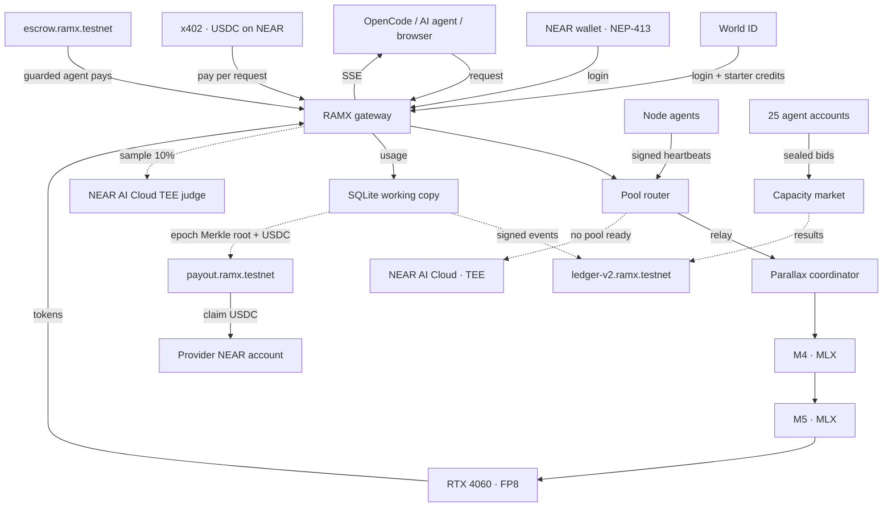

# RAMX

Large AI models exceed the memory of many everyday laptops, while nearby GPUs sit idle.
Connecting those machines is only half the problem: an open network also needs identity, live discovery, fair accounting, payments that AI agents can make on their own, and limits on what a compromised agent can spend.

**RAMX combines the RAM and GPUs of nearby Apple and NVIDIA computers into GPU Pools, and runs the marketplace on NEAR.** A **GPU Pool** is a group of nearby laptops that together serve one AI model: each machine holds only a slice of the model's layers, so the pool runs a model that none of its members could load alone. Providers contribute compute and earn USDC; people and AI agents send prompts through an OpenAI-compatible API using credits or per-request x402 payments in USDC on NEAR. Every balance change is signed and written to a NEAR contract, providers claim USDC from a Merkle payout contract, and an agent can be given a wallet that the chain itself keeps within a budget. Built for NEAR HACKATHON 2026.

[Repository](https://github.com/yashhhhapexxxx/RAMX) · Website: [ramx-eight.vercel.app](https://ramx-eight.vercel.app) · Hosted gateway: [ramx-gateway.onrender.com](https://ramx-gateway.onrender.com) · Demo video: _TODO_

## Our approach

The **gateway chooses a GPU Pool; Parallax chooses its GPU stages**. Model layers stay on the workers, which exchange hidden states over the local network. The gateway handles identity, billing, payments and routing; NEAR holds the money and the audit trail. When no GPU Pool is ready, the gateway serves the request from a model in NEAR AI Cloud's secure hardware (TEE).



- **World ID** gives starter credits, once per verified human, and backs budgeted API keys. **NEAR wallets** (Meteor, MyNearWallet) log in with a signed NEP-413 message; the gateway checks on chain that the key is a full-access key of the account. Wallet logins get no starter credits: they top up with USDC.
- **Discovery** comes from signed node heartbeats inside the gateway. Routing checks fresh heartbeats, reliability and layer coverage.
- **SQLite + NEAR** handle atomic credit holds, usage settlement and an asynchronous signed audit trail on `ledger-v2.ramx.testnet`. Credits split 90% to serving nodes by layers, 5% burn and 5% reserve. 80% of x402 USDC income goes to providers each epoch: the treasury funds and posts a Merkle root in one `ft_transfer_call`, and each provider claims its own leaf.
- **Guarded agents.** An agent account can hold only a function-call key for `escrow.pay`. The escrow contract enforces the owner's policy on chain: allowed payees, a per-call maximum, a total budget and a pause switch. A prompt-injected agent cannot pay anyone else, overspend or change its own limits.
- **Honest billing.** The gateway bills `min(reported output tokens, observed + 8)`; a pool that over-reports loses reliability. A 10% sample of pool answers is judged by a NEAR AI Cloud TEE model with a fresh-nonce attestation and a signed response (a plausibility check, not proof of correct execution). Answers served by NEAR AI Cloud carry their attestation on the receipt.
- **Capacity market.** AI agents bid for priority slots in 30-second sealed-bid rounds (commit, reveal, one uniform price per model). Each agent is its own NEAR account and signs its own bids; results go on the ledger. Rules: [swarm-sim/RULES.md](swarm-sim/RULES.md).
- **OpenCode tools run on the requester's laptop.** The gateway translates model tool calls into the OpenAI protocol.

## Contracts and accounts (NEAR testnet)

| What | Account |
|---|---|
| Audit ledger (signed events, NEP-297 logs) | [`ledger-v2.ramx.testnet`](https://testnet.nearblocks.io/address/ledger-v2.ramx.testnet) (first test run: [`ledger.ramx.testnet`](https://testnet.nearblocks.io/address/ledger.ramx.testnet), same signing key) |
| Epoch payouts (Merkle claims in USDC) | [`payout.ramx.testnet`](https://testnet.nearblocks.io/address/payout.ramx.testnet) |
| Guarded agent wallet | [`escrow.ramx.testnet`](https://testnet.nearblocks.io/address/escrow.ramx.testnet) |
| Treasury (x402 payee, epoch settler) / x402 relayer (pays gas) | `treasury.ramx.testnet` / `relayer.ramx.testnet` |
| Open agent (pays with x402) / guarded agent (function-call key on `escrow.pay` only) | `agent-1.ramx.testnet` / `agent-2.ramx.testnet` |
| Market agents | `buyer-1…20.swarm.ramx.testnet`, `seller-1…5.swarm.ramx.testnet` |
| USDC (Circle, 6 decimals) | `3e2210e1184b45b64c8a434c0a7e7b23cc04ea7eb7a6c3c32520d03d4afcb8af` |

## Set up and use

### Call the API

Log in on the app, create a capped key on **Keys**, and export it locally:

```bash
export RAMX_API_KEY='your-api-key'
export RAMX_BASE_URL='https://<hosted gateway>'   # TODO: hosted URL

curl "$RAMX_BASE_URL/v1/chat/completions" \
  -H "Authorization: Bearer $RAMX_API_KEY" \
  -H 'Content-Type: application/json' \
  -d '{"model":"Qwen/Qwen3-14B-FP8","messages":[{"role":"user","content":"Explain pooled inference briefly."}],"max_tokens":128,"stream":true}'
```

Available models: `GET /v1/models`. For **OpenCode**, copy the configuration from Keys into your project's `opencode.json`, then run `opencode`. Requests spend credits; without a session, the gateway answers `402` and an agent pays per request with x402 in USDC on NEAR testnet.

### Try it: do X, see Y

You need Node.js 24+, pnpm and [near-cli-rs](https://github.com/near/near-cli-rs). Testnet USDC: [faucet.circle.com](https://faucet.circle.com) (NEAR Testnet).

```bash
git clone https://github.com/yashhhhapexxxx/RAMX.git && cd RAMX
pnpm install
```

1. **Check the on-chain audit trail (no keys needed).** Each event's schema and gateway signature is checked against the key the contract publishes:
   ```bash
   node gateway/src/verify-event.ts GbVxSJh5HzigSiQDBwTEJppGUzaBhzg2g6pAhXZeTbXZ
   # → {"contract":"ledger-v2.ramx.testnet","seq":9,"type":"x402_payment","schema":"valid","signature":"valid"}
   ```
2. **Watch a prompt-injected agent get refused on chain:** `pnpm --filter @ramx/agent-client attack` (pay a stranger, exceed the per-call cap, drain the budget, use the key on USDC directly, change its own policy: all five refused).
3. **Guarded agent, legitimate path:** `pnpm --filter @ramx/agent-client guarded --usdc 0.5` pays through the escrow, is credited to its API key, and gets an answer.
4. **Pay per request with x402:** `pnpm --filter @ramx/gateway e2e:testnet --questions 2` pays in USDC, serves the answers, writes the ledger events and verifies them, and prints every NearBlocks link.
5. **Run the capacity market:** `pnpm --filter @ramx/swarm-sim start`, then open `/swarm` in the app.
6. **Check the TEE attestation:** `node --env-file=gateway/.env gateway/scripts/tee-attest.ts`.

### Contribute a laptop

Open **Getting started** in the app. Choose **Create Pool** or **Join Pool ID**, log in, and enter your NEAR payout account. The coordinator approves members; each owner runs the generated one-command helper locally. The helpers discover LAN IPs, prepare dependencies, download each model format once on the coordinator, transfer and verify caches, and synchronize node startup. Keep the helper running; progress appears in the app. Details: [pool/README.md](pool/README.md), [node-agent/README.md](node-agent/README.md).

Providers claim their USDC with `node --env-file=gateway/provider.env gateway/scripts/claim-payout.ts --broadcast` (the payout account must be registered on the USDC contract).

### Run your own gateway and frontend

```bash
scripts/near-setup.sh                 # testnet accounts, contracts, USDC registration, .env files
scripts/near-check.sh                 # verifies all of it
cp -n frontend/.env.example frontend/.env.local
pnpm --filter @ramx/gateway start     # localhost:8080
pnpm --dir frontend dev               # localhost:5173
```

Configure `gateway/.env` with your World ID app, JWT/signing key, NEAR accounts and the NEAR AI Cloud key (`NEARAI_API_KEY`). Set `PUBLIC_URL` to the reachable gateway URL and `CORS_ORIGINS` to your frontend origin. Secrets live only in `gateway/.env` and `agent-client/.env` (git-ignored); never put a key in a `VITE_*` variable. Starting the web services does not create pool capacity: onboard a pool from the app, or let NEAR AI Cloud serve until one is ready. Contracts: [contracts-near/README.md](contracts-near/README.md).

## On-chain evidence (NEAR testnet)

| Action | Transaction |
|---|---|
| Agent pays per request with x402 (USDC → treasury) | [G3rzbD…](https://testnet.nearblocks.io/txns/G3rzbD1y6sEfAfJA79tH8aQmBYsj3jYDEEM5XphzNJY4), [2v7At7…](https://testnet.nearblocks.io/txns/2v7At7Ez6x31TtsaZyntsBSPrwnuBVmoygSDPXgMgdth) |
| Signed ledger events for those payments (verified) | [GbVxSJ…](https://testnet.nearblocks.io/txns/GbVxSJh5HzigSiQDBwTEJppGUzaBhzg2g6pAhXZeTbXZ), [GTduTH…](https://testnet.nearblocks.io/txns/GTduTHBtBbqRHLFDa27tmfrhqHCiUGaCNcUkVDvy91EA) |
| Guarded agent pays through the escrow, then gets an answer | [9gFGWr…](https://testnet.nearblocks.io/txns/9gFGWr23xEkdqPXF97T5Y5FHNgP6caHTaqA7sEyRXaPh) |
| Refused on chain: payee not on the allow list | [J4YypM…](https://testnet.nearblocks.io/txns/J4YypMMUmYSDv87xA4bAjUTTUELAaFofrzy5zS7J3hja) |
| Refused on chain: above the per-call limit | [EKwP6t…](https://testnet.nearblocks.io/txns/EKwP6tQZLgaHQNFS9ALqJavzjpUD73t4VrZH1TAJxTFG) |
| Capacity-market round cleared (first ledger) | [GfbcX7…](https://testnet.nearblocks.io/txns/GfbcX7ofwgcJHVG2Q2meXCjpEGdXn3zZ1dypo2QP88jz) |
| Agent pays with x402, answer served by a GPU Pool (Qwen3-8B) | [Gpxq3h…](https://testnet.nearblocks.io/txns/Gpxq3hxD4JVWvgmAS2Ps6Y4j4DG2CyQWoSssWYvzk1j3), [DtrZwH…](https://testnet.nearblocks.io/txns/DtrZwHJwdg62Xd6K6T4Lo29zt5GqtZKbGFgV6urXG1pd), [TSu5Cy…](https://testnet.nearblocks.io/txns/TSu5CyYnuLC8G4wAFmkPR1h3DJytX42LJ1rggfgUmfc) |
| Treasury posts the epoch payout (Merkle root + USDC) | [AuYYgQ…](https://testnet.nearblocks.io/txns/AuYYgQ1kdt1wU5NGxmEt8Ah3mi5fTDMQyqb2qoVh4wRw) |
| Provider claims its share with a Merkle proof (80% of the x402 income → `provider-1.ramx.testnet`) | [B8ZaniL…](https://testnet.nearblocks.io/txns/B8ZaniLqcTAva9EoWiLuDZv1iqvfSi1dQVsxPhQhGPqK) |

## Pool benchmarks

Real laptops, real runs: each pool below was run by our team on our own machines over a local network with Parallax, each laptop holding only a slice of the model's layers. All the test runs are made during the hackathon period and a proof on NEAR testnet with  payment and payout on chain. Hardware, method and lessons: [POOL-BENCHMARKS.md](POOL-BENCHMARKS.md).

| # | Laptops in the pool | Model | How the model is split | Speed | What it proves |
|---|---|---|---|---|---|
| 1 | **1** · RTX 4060 | Qwen3-0.6B | whole model on the 4060 | **≈ 135 tok/s** | One NVIDIA laptop serves a model on its own |
| 2 | **1** · M4 MacBook Air | Qwen3-8B (MLX 8-bit) | whole model on the M4 | **≈ 7.9 tok/s** | A Mac joins the pool over the local network |
| 3 | **2** · M4 + RTX 4060 | Qwen3-14B | M4: layers 0–28 → 4060: layers 29–39 | **5.2–6.0 tok/s** · first token 0.65–1.2 s | Apple + NVIDIA run one model **neither laptop can run alone** |
| 4 | **3** · M4 + M5 + RTX 4060 | Qwen3-14B | M4: 0–13 → M5: 14–28 → 4060: 29–39 | **7.92 tok/s** (median) · first token 0.43 s | Three-laptop pipeline, 5 of 5 runs passed |
| 5 | **1** · RTX 4060 with llama.cpp (reference, not a pool) | Qwen2.5-7B (4-bit) | whole model | **53.5 tok/s** | The single-GPU speed limit, for comparison |
| 6 | **GPU Pool on NEAR testnet** | Qwen3-8B | chosen by Parallax | 3 paid answers | Paid with x402 ([Gpxq3h…](https://testnet.nearblocks.io/txns/Gpxq3hxD4JVWvgmAS2Ps6Y4j4DG2CyQWoSssWYvzk1j3)), ledger events #24–26 verified, provider payout claimed ([B8ZaniL…](https://testnet.nearblocks.io/txns/B8ZaniLqcTAva9EoWiLuDZv1iqvfSi1dQVsxPhQhGPqK)) |

*tok/s = tokens generated per second. Layer numbers are the model layers each laptop holds (Qwen3-14B has 40).*

## Tracks

Each track below links to a short write-up and to the on-chain transactions that back it.

| Track | What RAMX delivers | Proof on NEAR testnet | Write-up |
|---|---|---|---|
| **AI Security & Defense** | A guarded agent holds only a function-call key for `escrow.pay`; the escrow contract enforces the owner's policy on chain (allowed payees, per-call cap, total budget, pause). `pnpm attack` runs five prompt-injection attacks and all five are refused by the chain. Signed ledger events, NEP-413 login checked against on-chain keys, billing capped at observed tokens, vesting and clawback. | [J4YypM…](https://testnet.nearblocks.io/txns/J4YypMMUmYSDv87xA4bAjUTTUELAaFofrzy5zS7J3hja), [EKwP6t…](https://testnet.nearblocks.io/txns/EKwP6tQZLgaHQNFS9ALqJavzjpUD73t4VrZH1TAJxTFG), [9gFGWr…](https://testnet.nearblocks.io/txns/9gFGWr23xEkdqPXF97T5Y5FHNgP6caHTaqA7sEyRXaPh) | [AI-SECURITY-AND-DEFENSE.md](AI-SECURITY-AND-DEFENSE.md) |
| **Agent Economy** | AI agents buy inference on their own: HTTP 402 → USDC payment with x402 → answer, no sign-up. A relayer pays the gas; API keys carry budgets; open and guarded agent modes. Providers are paid from agent income every epoch. OpenCode support. | [Gpxq3h…](https://testnet.nearblocks.io/txns/Gpxq3hxD4JVWvgmAS2Ps6Y4j4DG2CyQWoSssWYvzk1j3), [B8ZaniL…](https://testnet.nearblocks.io/txns/B8ZaniLqcTAva9EoWiLuDZv1iqvfSi1dQVsxPhQhGPqK) | [AGENT-ECONOMY.md](AGENT-ECONOMY.md) |
| **Open Innovation** | Idle laptop memory becomes a shared AI utility: several consumer laptops (Apple MLX and NVIDIA) serve one model none of them could load alone, behind an OpenAI-compatible API. Every balance change is a signed event on the ledger contract; providers are paid through an on-chain Merkle payout with an open format and a cross-language test vector. | [TSu5Cy…](https://testnet.nearblocks.io/txns/TSu5CyYnuLC8G4wAFmkPR1h3DJytX42LJ1rggfgUmfc), [AuYYgQ…](https://testnet.nearblocks.io/txns/AuYYgQ1kdt1wU5NGxmEt8Ah3mi5fTDMQyqb2qoVh4wRw) | [OPEN-INNOVATION.md](OPEN-INNOVATION.md) |
| **Privacy & Private AI** | Per-request privacy with `x-ramx-privacy`: `trusted-ends`, `trusted-all`, or `tee` (NEAR AI Cloud model in secure hardware, fresh-nonce attestation on the receipt). The chain stores only salted prompt/response hashes, with the salt returned to the caller alone; transcripts are AES-256-GCM encrypted and deleted after 7 days; private requests are never sent to the TEE judge. | `node --env-file=gateway/.env gateway/scripts/tee-attest.ts` | [PRIVACY-AND-PRIVATE-AI.md](PRIVACY-AND-PRIVATE-AI.md) |
| **AI Swarms** | 25 autonomous agents, each its own NEAR account, trade priority inference slots in 30-second commit–reveal sealed-bid rounds with one uniform price per model and pooled group orders. Every cleared round is on the ledger with hashes anyone can recompute. | [GfbcX7…](https://testnet.nearblocks.io/txns/GfbcX7ofwgcJHVG2Q2meXCjpEGdXn3zZ1dypo2QP88jz) | [AI-SWARMS.md](AI-SWARMS.md) |
| **Autonomous Business** | A laptop that earns while its owner sleeps: it serves requests overnight and earns credits for the same models plus a share of customer payments. Prices adjust to demand every 30 seconds, earnings split by layers served, payouts settle each epoch with no manual payroll, and a reserve is kept from every payment. | [AuYYgQ…](https://testnet.nearblocks.io/txns/AuYYgQ1kdt1wU5NGxmEt8Ah3mi5fTDMQyqb2qoVh4wRw), [B8ZaniL…](https://testnet.nearblocks.io/txns/B8ZaniLqcTAva9EoWiLuDZv1iqvfSi1dQVsxPhQhGPqK) | [AUTONOMOUS-BUSINESS.md](AUTONOMOUS-BUSINESS.md) |

## What challenged us

- **x402 on NEAR needs full-access keys:** a NEP-366 delegate can move all of an agent's USDC. We split agents into open and guarded ones and put the guard in a contract, not in the agent.
- **Mixed hardware:** NVIDIA FP8 and Apple MLX need different model snapshots but must serve the same layer pipeline.
- **Mac memory pressure:** oversized KV caches caused swapping and stalls. Bounded caches and a 4K sequence limit made the tested pool usable.
- **Pool lifecycle:** stale peers, orphaned processes and untimed joins broke placement. Process-group cleanup, runtime hooks and synchronized starts helped recovery.
- **Accounting across systems:** inference, the ledger contract and payouts finish at different times. Atomic local transactions, ordered contract appends that refuse duplicates (`first_seq`), and pending receipts keep those states separate.
- **Public RPC limits:** `rpc.testnet.near.org` is deprecated and rate-limited; we use FastNEAR.

## What's next

- Settle capacity-market orders in USDC through the escrow.
- Turn the TEE plausibility check into calibrated output verification.
- Improve recovery from failed pipeline stages; test WAN pools; more hardware and MoE models.
- Batch provider claims; harden the system before considering mainnet payments.

## Built with

Parallax (distributed inference), Hono, better-sqlite3, React + Vite, `near-sdk` 5 (Rust), cargo-near, near-cli-rs, `@near-js/*`, `@x402/core` + `@x402/near`, `@near-wallet-selector`, NEAR AI Cloud, World IDKit, viem (EIP-191 signature recovery), zod. Some code was written with AI coding assistants.
